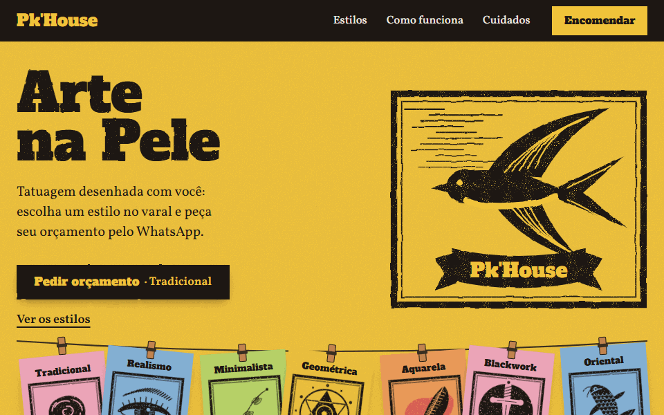
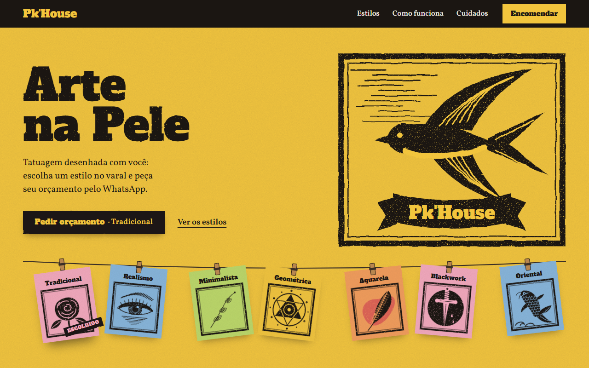
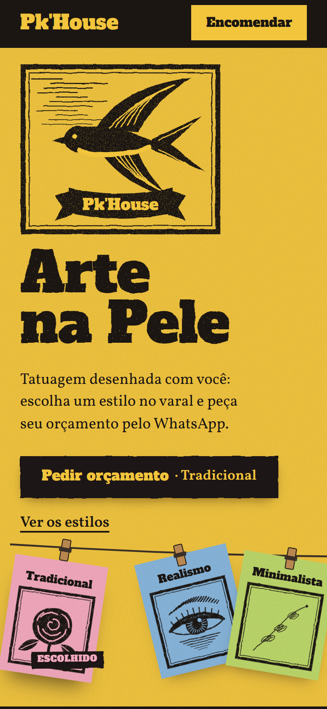

# Pk'House Studio

**Projeto conceitual de portfólio:** um estúdio de tatuagem apresentado como uma banca de cordel. Cada estilo é uma xilogravura pendurada no varal, e escolher um folheto já começa o pedido de orçamento.

**[Ver o site no ar](https://phaaek013.github.io/tattoo-studio/)**



O Pk'House é um estúdio fictício. O pedido funciona em modo demonstração: monta a mensagem que chegaria no WhatsApp e não envia nada.

## A ideia

Site de estúdio de tatuagem costuma ser igual: fundo preto, detalhe laranja ou neon e uma grade de fotos. Aqui o ponto de partida foi a xilogravura dos folhetos de cordel, que tem o mesmo traço preto e grosso de muita tatuagem e é parte da cultura visual brasileira.

- **O varal é o menu.** Os sete estilos (tradicional, realismo, minimalista, geométrica, aquarela, blackwork e oriental) ficam pendurados por pregadores e balançam quando a página rola. Clicar num folheto escolhe o estilo para o pedido.
- **Cada seção é um papel de folheto:** amarelo, rosa, verde, laranja e azul, sempre com uma tinta só.
- **O processo vira um folheto aberto:** a mesma rosa em esboço, traço e pronta, e o passo a passo contado em duas sextilhas.
- **O pedido é um talão:** estilo, ideia, lugar do corpo e tamanho. O resultado é a mensagem pronta para o WhatsApp do estúdio.

<p align="center">
  
  &nbsp;
  
</p>

## Como foi feito

- **Gravuras sem imagem nenhuma:** todas são SVG desenhado à mão no código (`src/art/prints.tsx`). Um filtro SVG deixa as bordas irregulares e abre falhas na tinta, como numa matriz de madeira.
- **Varal com física simples:** cada folheto é uma mola amortecida que reage à velocidade do scroll. Para quem pede "reduzir movimento", eles ficam parados.
- **Direção de arte** escolhida e revisada com a skill [impeccable](https://github.com/ourslyio/impeccable). O perfil do produto está em `project/PRODUCT.md` e o sistema visual em `project/DESIGN.md`.
- React, TypeScript, Vite e Tailwind. Fontes Alfa Slab One e Vollkorn, hospedadas no próprio projeto.
- Publicado no GitHub Pages por um fluxo do GitHub Actions (`.github/workflows/pages.yml`).

## Rodar no computador

```bash
cd project
npm install
npm run dev
```

## Usar com um estúdio de verdade

Preencha o número de WhatsApp em `project/src/components/Encomenda.tsx` (DDI + DDD + número, só dígitos). Com o número preenchido, o talão passa a mostrar o botão "Enviar pelo WhatsApp" com o pedido já escrito:

```ts
const WHATSAPP = '5511999999999';
```

## Créditos

Design e desenvolvimento: [Raphael Otávio](https://github.com/Phaaek013).

Fontes: Alfa Slab One e Vollkorn, ambas sob a SIL Open Font License 1.1.
